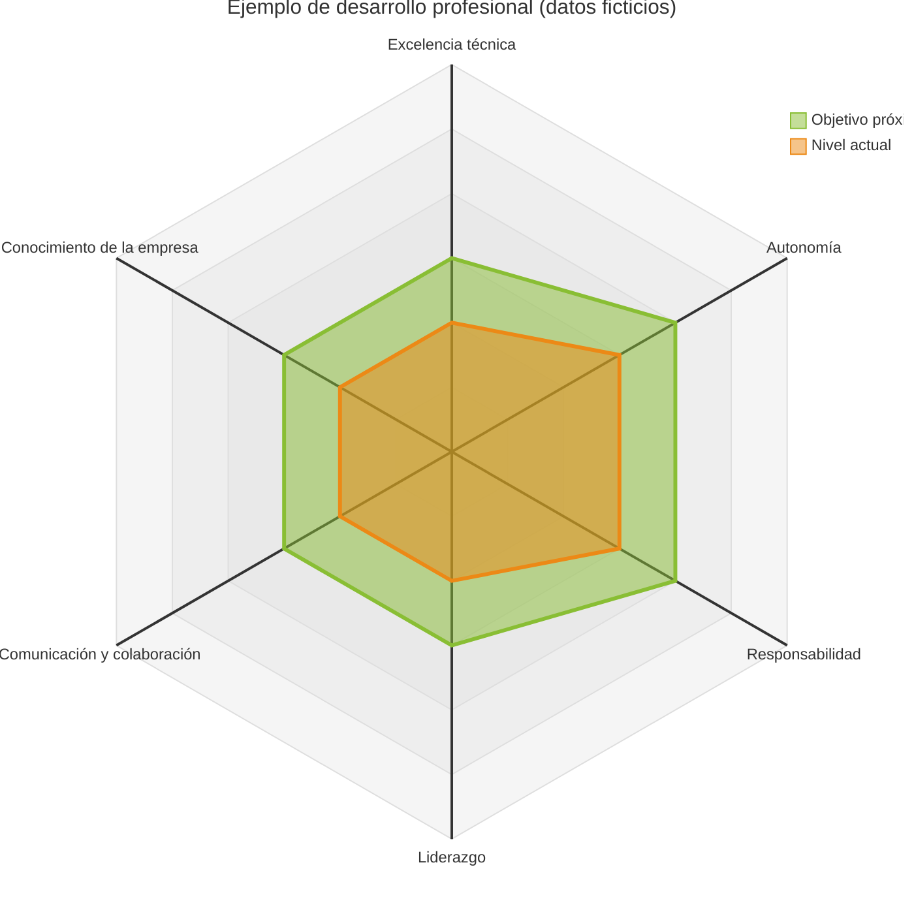
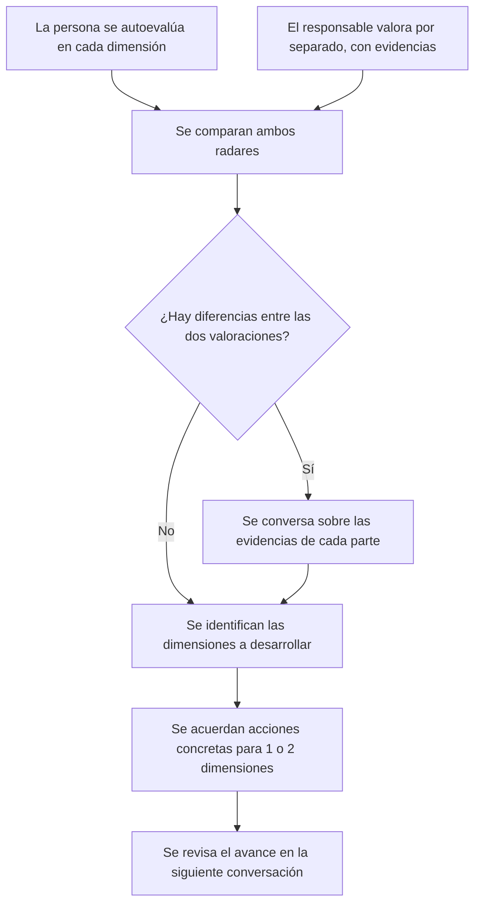
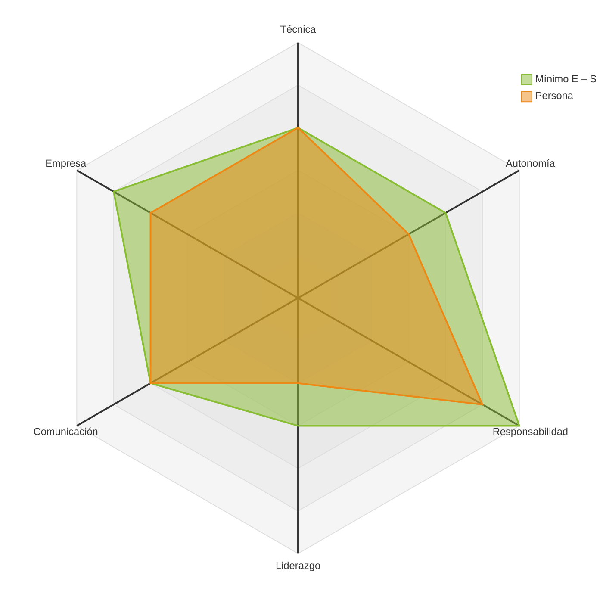

# Carrera profesional en TI

Este modelo de desarrollo profesional ayuda a las personas que trabajan en tecnología a identificar su nivel, reconocer sus fortalezas y planificar su crecimiento. Puede adaptarse a las necesidades de cada organización.

Su objetivo principal es facilitar **conversaciones significativas** entre cada persona y su responsable sobre las expectativas de cada nivel y los siguientes pasos de su carrera. No es una calculadora de ascensos ni una lista de comprobación.

## Seis dimensiones

El desarrollo profesional se analiza en seis dimensiones, valoradas de forma independiente en una escala del **1 al 6**. Cada nivel incluye los anteriores: quien está en el nivel 3 de una dimensión también cumple lo descrito en los niveles 1 y 2. Una persona puede tener un nivel elevado de autonomía y estar todavía desarrollando su liderazgo.

1. [Excelencia técnica y resolución de problemas](dimensiones/excelencia-tecnica.md): capacidad para resolver problemas y tomar buenas decisiones técnicas.
2. [Autonomía](dimensiones/autonomia.md): capacidad para avanzar y tomar decisiones sin necesitar supervisión constante.
3. [Responsabilidad](dimensiones/responsabilidad.md): responsabilidad sobre el trabajo, sus resultados y los ámbitos asignados.
4. [Liderazgo](dimensiones/liderazgo.md): capacidad para influir positivamente en otras personas y contribuir a la mejora del equipo.
5. [Comunicación y colaboración](dimensiones/comunicacion-colaboracion.md): capacidad para comunicarse con claridad y colaborar eficazmente.
6. [Conocimiento de la empresa](dimensiones/conocimiento-empresa.md): comprensión de la organización y de cómo el trabajo propio afecta al conjunto.

### Mejora continua

La mejora continua forma parte de todas las dimensiones: aprender, mejorar, pedir feedback, revisar la forma de trabajar y compartir lo aprendido.

## Niveles profesionales

El nivel profesional se determina teniendo en cuenta el conjunto de las seis dimensiones.

| Grupo | Nivel | Descripción |
|---|---|---|
| I | Junior 1 | Inicio profesional. Aprende las herramientas, los procesos y la forma de trabajar de su área. |
| H | Junior 2 | Consolida los conocimientos básicos y empieza a trabajar con mayor autonomía. |
| G | Mid 1 | Resuelve de forma autónoma los problemas habituales de su área. |
| F | Mid 2 | Resuelve problemas de mayor complejidad y empieza a ayudar a otras personas. |
| E | Senior 1 | Cuenta con experiencia y capacidad para tomar decisiones relevantes dentro de su área. |
| D | Senior 2 | Es una persona de referencia dentro de su área. |

## Áreas de especialización

El modelo contempla dos áreas principales:

- **SAT / Sistemas:** soporte a usuarios, administración de sistemas, infraestructura, redes, seguridad y cloud.
- **Programación:** desarrollo de aplicaciones de gestión, incluidos sistemas ERP.

Las seis dimensiones y los niveles profesionales son comunes a las distintas áreas. Cada persona desarrolla sus competencias dentro de su especialización.

## Desarrollo a partir de Senior 2

A partir de Senior 2, el desarrollo profesional puede continuar por dos itinerarios: liderazgo técnico o gestión de equipos.

### Liderazgo técnico

El impacto aumenta mediante la profundidad técnica, la resolución de problemas complejos, el diseño y la arquitectura, la definición de estándares, la influencia técnica y el desarrollo de otras personas.

| Grupo | Nivel | Descripción |
|---|---|---|
| C | Tech Lead | Lidera técnicamente un área o dominio y ayuda a otros profesionales a tomar mejores decisiones técnicas. |
| B | Principal | Ejerce una influencia técnica transversal y participa en decisiones de alto impacto. |

### Gestión de equipos

El impacto aumenta mediante el desarrollo de personas y líderes, la organización del trabajo, el desarrollo de equipos, la contratación y la dirección estratégica.

| Grupo | Nivel | Descripción |
|---|---|---|
| C | Manager | Responsable de varios equipos o de un área relevante. |
| B | Director | Responsable de una parte significativa de la estrategia y la organización del departamento. |
| A | Jefe/a de Departamento | Máxima responsabilidad sobre un área del departamento. |

La gestión de equipos no implica abandonar completamente el conocimiento técnico. Del mismo modo, es posible alcanzar niveles profesionales elevados sin gestionar personas.

## Requisitos por nivel

Cada nivel profesional tiene un perfil mínimo esperado en las seis dimensiones.

| Grupo | Excelencia técnica | Autonomía | Responsabilidad | Liderazgo | Comunicación y colaboración | Conocimiento de la empresa |
|---|---:|---:|---:|---:|---:|---:|
| I – Junior 1 | 1 | 1 | 1 | 1 | 1 | 1 |
| H – Junior 2 | 2 | 2 | 2 | 1 | 1 | 2 |
| G – Mid 1 | 3 | 3 | 3 | 2 | 3 | 3 |
| F – Mid 2 | 3 | 3 | 4 | 2 | 3 | 4 |
| E – Senior 1 | 4 | 4 | 6 | 3 | 4 | 5 |
| D – Senior 2 | 5 | 5 | 6 | 3 | 4 | 6 |
| C – Tech Lead / Manager | 6 | 6 | 6 | 4 | 5 | 6 |
| B – Principal / Director | 5 | 6 | 6 | 5 | 5 | 6 |
| A – Jefe/a de Departamento | 5 | 6 | 6 | 6 | 6 | 6 |

El radar permite visualizar el perfil de una persona, sus fortalezas y sus áreas de desarrollo. La evaluación del nivel tiene en cuenta el conjunto del perfil. El gráfico de este documento muestra datos ficticios.

Puedes ver el radar del perfil mínimo de cada nivel en [Perfil mínimo por nivel](perfiles-por-nivel.md).

## Cómo usar este modelo

El modelo está pensado para preparar y guiar conversaciones de carrera, por ejemplo en las reuniones 1:1. La clave no es la puntuación, sino hablar de las diferencias entre cómo se ve cada persona y cómo la ve su responsable.

1. **Autoevaluación.** La persona lee los niveles de cada dimensión y valora dónde se encuentra, con ejemplos de su trabajo.
2. **Valoración del responsable.** Lo hace de forma independiente, apoyándose en evidencias: 1:1, feedback de otras personas y equipos, y resultados.
3. **Comparación.** Se superponen ambos radares. Las diferencias de un nivel o más son el mejor punto de partida para la conversación.
4. **Conversación.** Se habla de qué evidencias ve cada parte y por qué llegan a valoraciones distintas.
5. **Plan de acción.** Se acuerdan acciones concretas para una o dos dimensiones, sin intentar mejorarlo todo a la vez.

Para decidir en qué trabajar puede ayudar consultar las [señales de alerta por etapa](senales-de-alerta.md), comportamientos que frenan el desarrollo en cada momento. Se usan como preguntas para la conversación, nunca para puntuar.

El siguiente ejemplo, con datos ficticios, compara a una persona con el perfil mínimo de Senior 1:

En este ejemplo, la conversación se centraría en autonomía, responsabilidad, liderazgo y conocimiento de la empresa, que están por debajo del perfil mínimo.

### Cuándo está lista una persona para el siguiente nivel

El cambio de nivel no depende de una única valoración. Antes de formalizarlo, conviene comprobar que la persona ya rinde al nivel siguiente de forma sostenida durante varios meses, y no solo en momentos puntuales.

### Adaptarlo a tu organización

Las dimensiones, los niveles y las descripciones pueden modificarse para reflejar la realidad de cada organización. Lo más útil suele ser que cada equipo complete las descripciones con ejemplos de comportamiento propios, porque dependen de sus herramientas, sus sistemas y su forma de trabajar.

## Autoría y licencia

Creado por [Javi Gallego Ferris](https://www.linkedin.com/in/javi-gallego-ferris-17704583/).

Este contenido se comparte bajo la licencia [Creative Commons Reconocimiento 4.0 Internacional (CC BY 4.0)](https://creativecommons.org/licenses/by/4.0/deed.es). Consulta [LICENCIA.md](LICENCIA.md).
