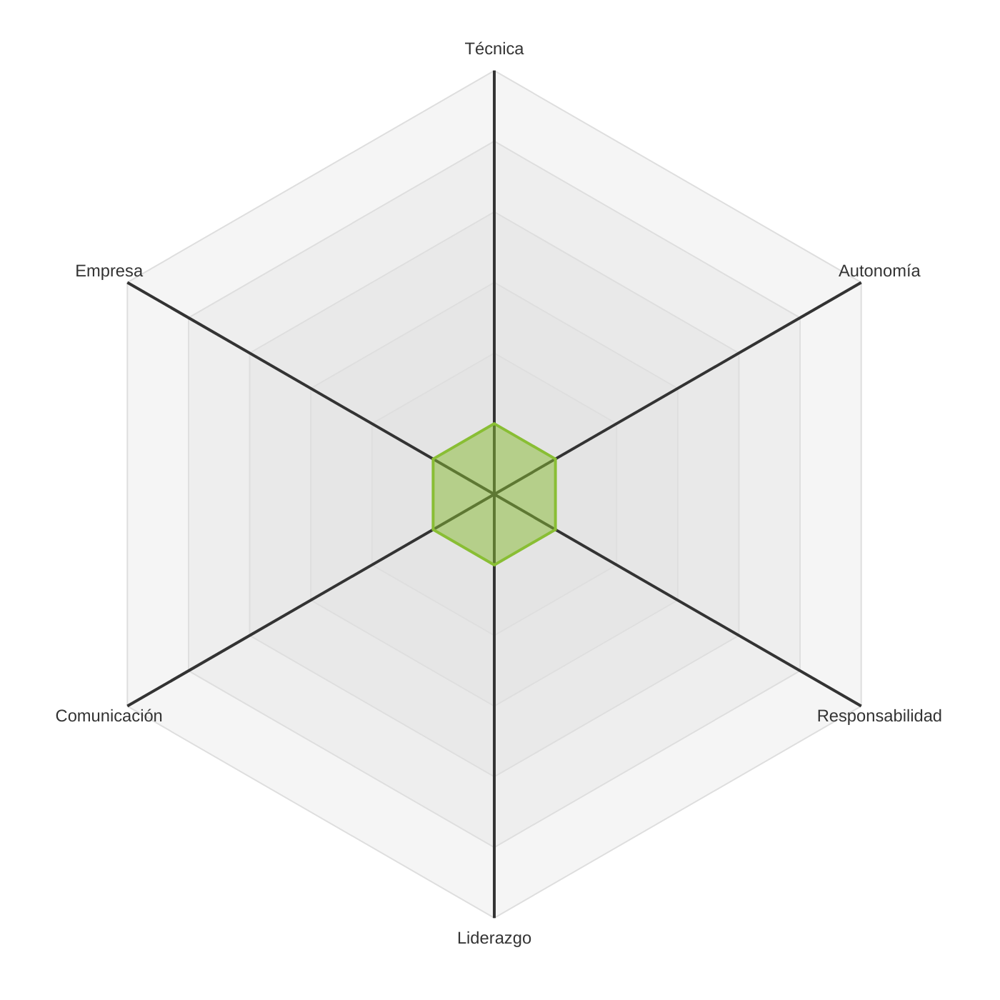
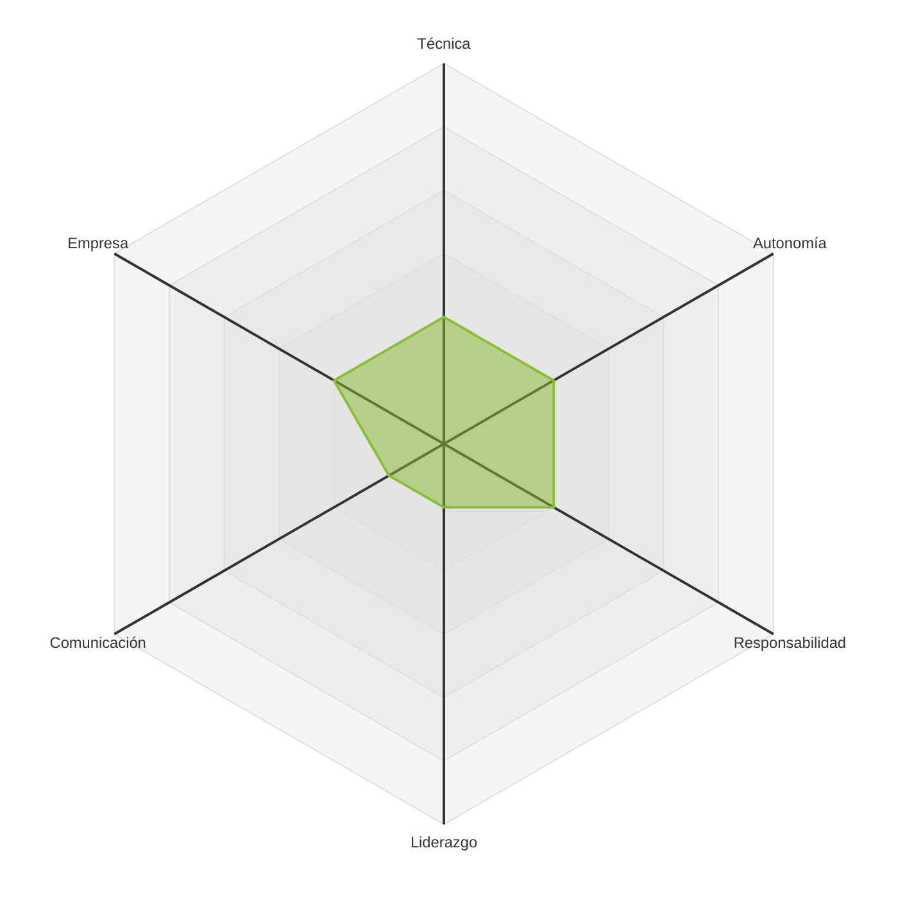
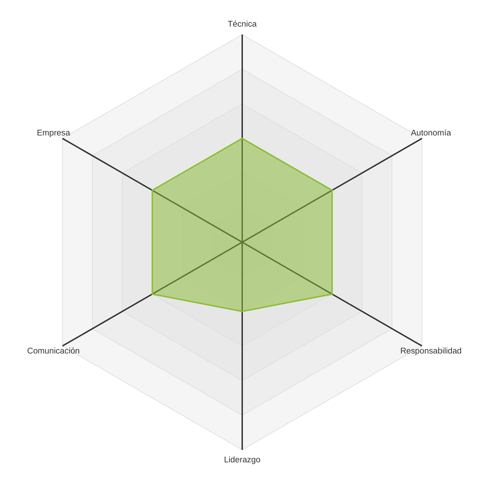
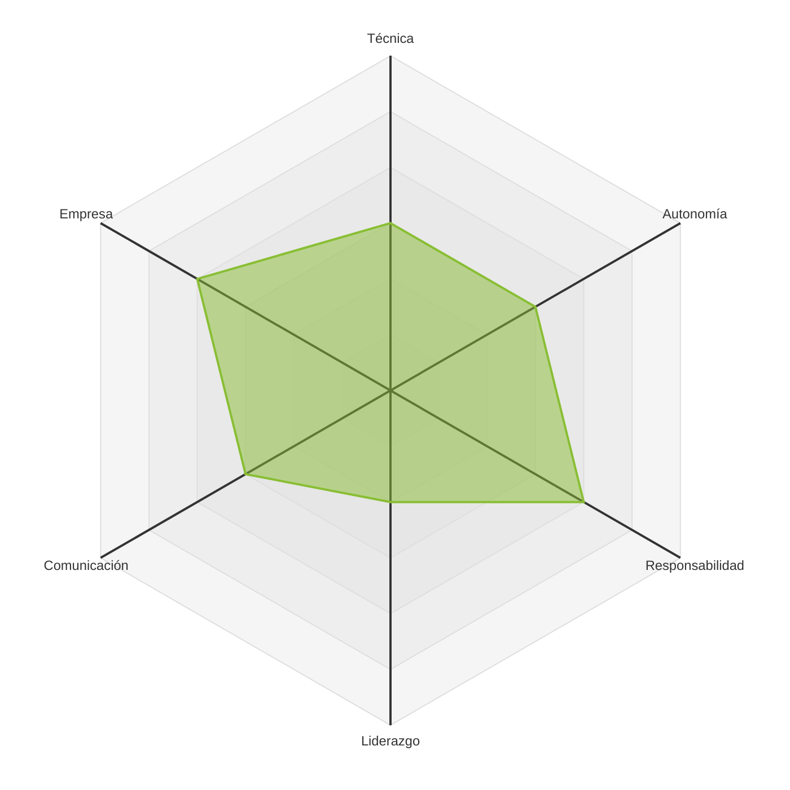
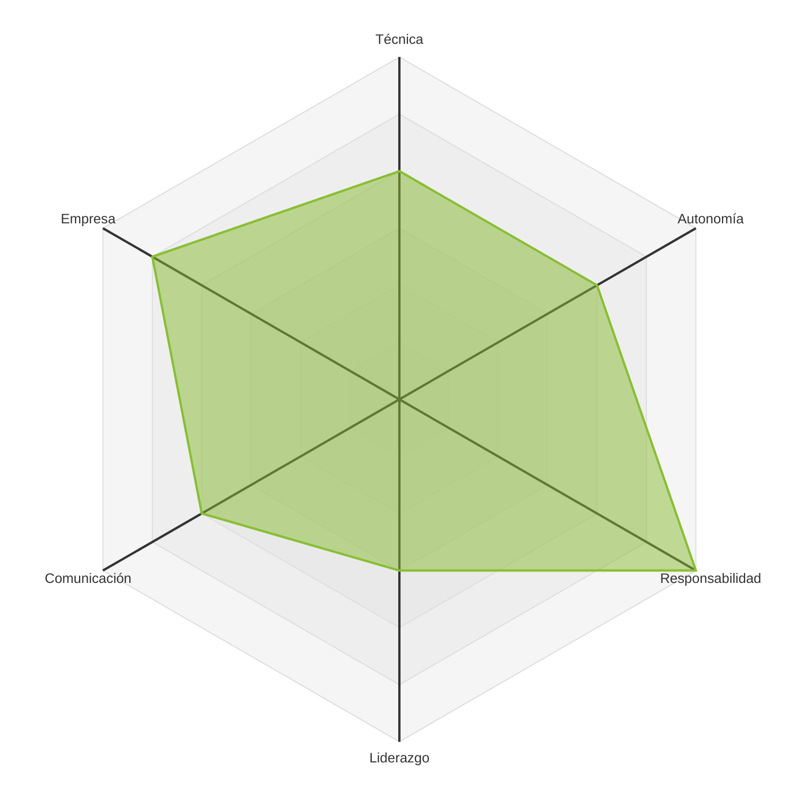
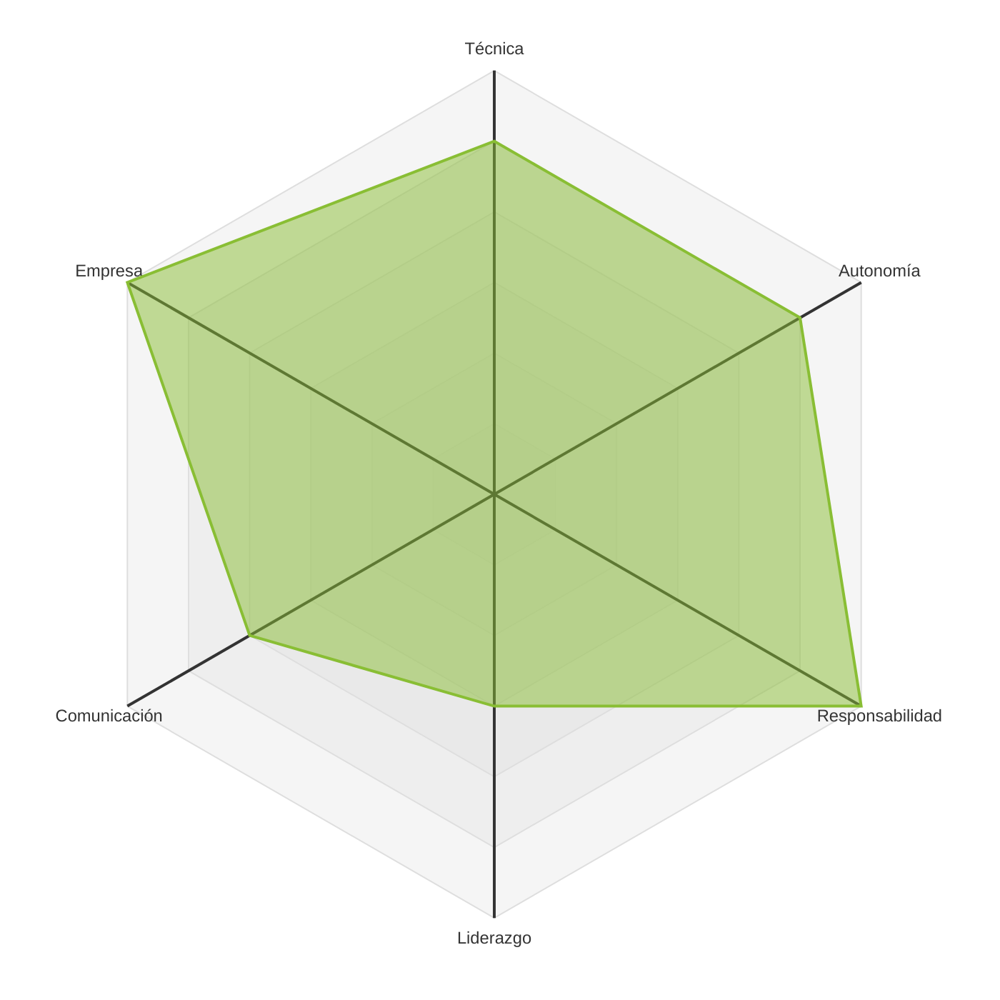
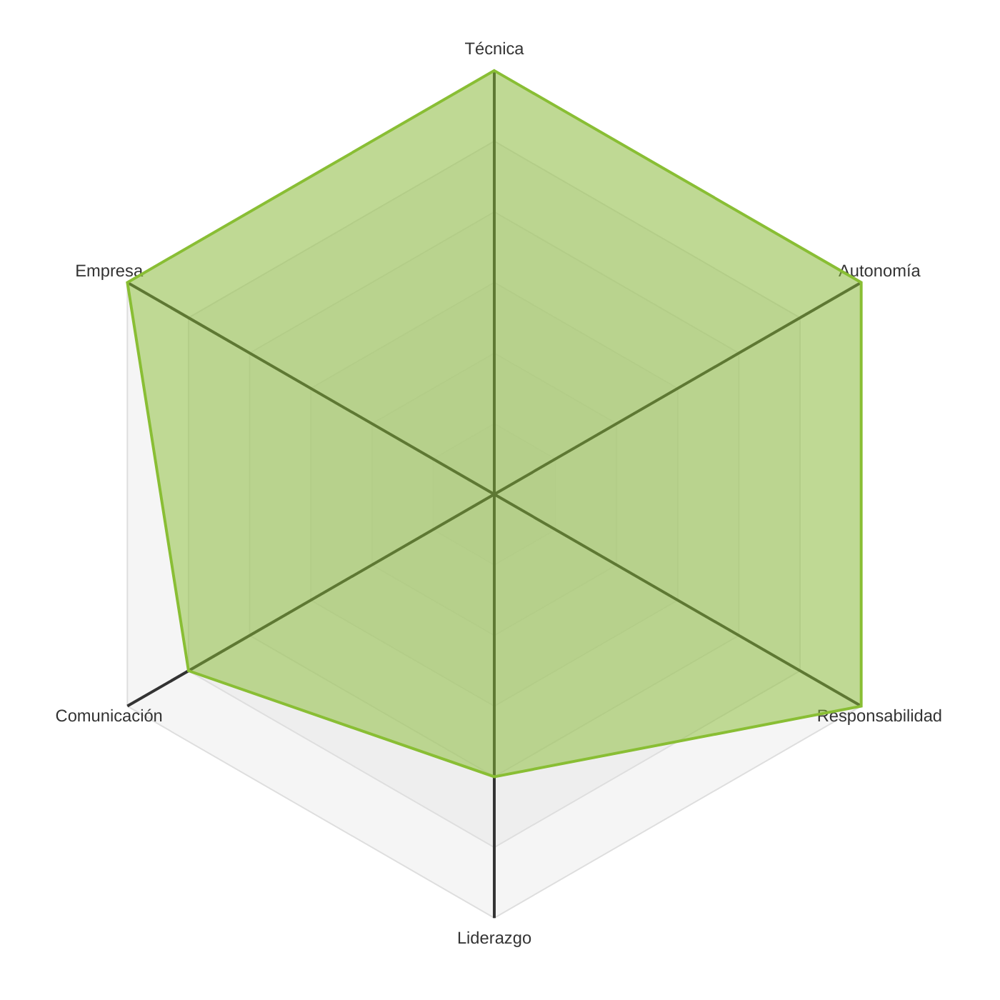
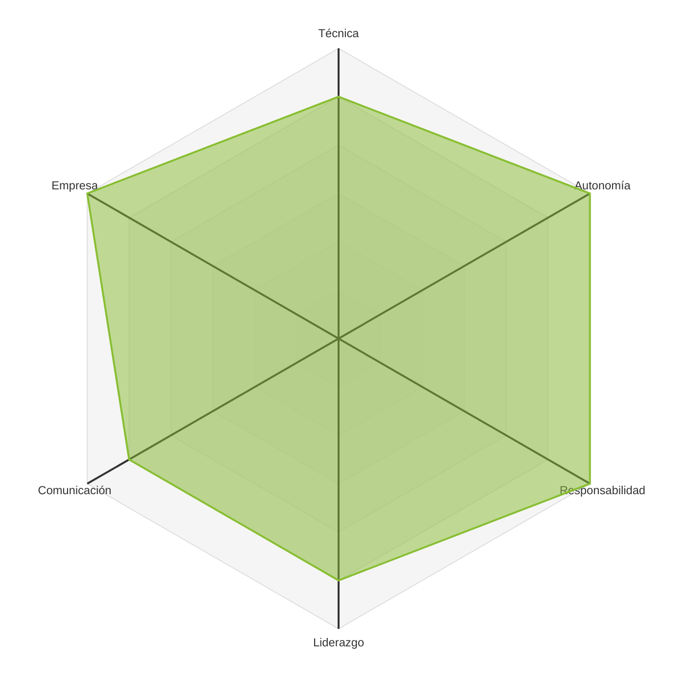
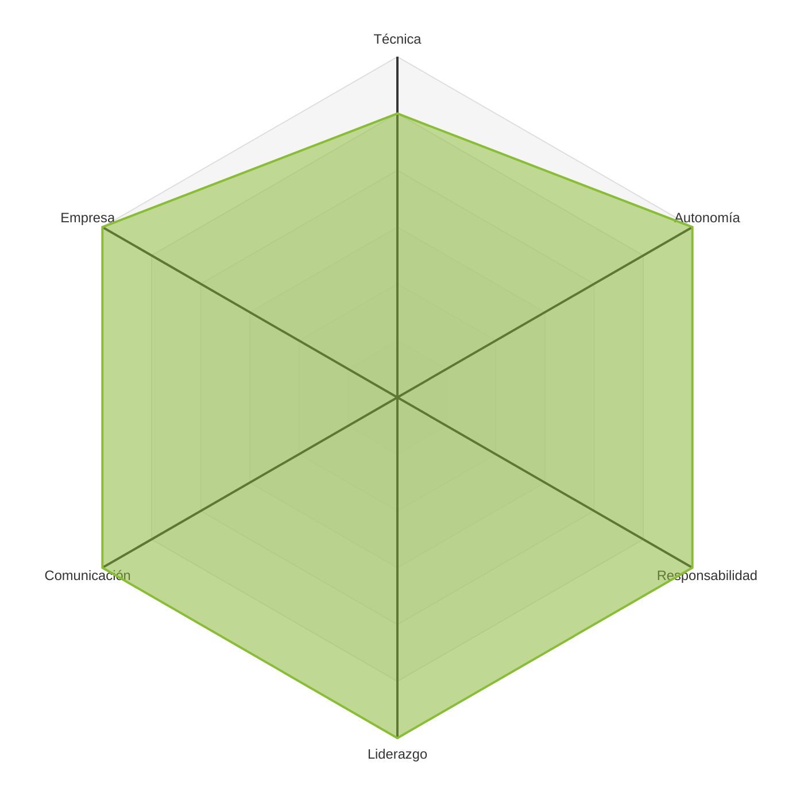

# Perfil mínimo por nivel

Radar del perfil mínimo esperado en cada nivel profesional, con las seis dimensiones en una escala del 1 al 6. Los valores proceden de la tabla [Requisitos por nivel](README.md#requisitos-por-nivel).

Sirven para comparar el perfil de una persona con el nivel al que aspira. Los niveles **Tech Lead / Manager** y **Principal / Director** comparten grupo en la tabla, por lo que se muestran juntos.

> Los diagramas usan [Mermaid](https://mermaid.js.org/syntax/radar.html). Si tu visor no los renderiza, comprueba que admite el tipo `radar-beta`.

## I – Junior 1

## H – Junior 2

## G – Mid 1

## F – Mid 2

## E – Senior 1

## D – Senior 2

## C – Tech Lead / Manager

## B – Principal / Director

## A – Jefe/a de Departamento

## Cómo usarlos

Para comparar a una persona con un nivel, añade una segunda curva con su valoración en cada dimensión. Hay un ejemplo en [Cómo usar este modelo](README.md#cómo-usar-este-modelo).
